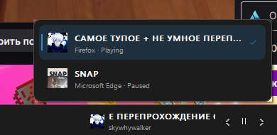
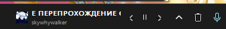

# SoundDeck

Now-playing media controls, right on the Windows taskbar. A tiny native tray app
written in Rust — no runtime, no installer, no background service.



## Features

- **Taskbar strip** next to the clock: album art, title, artist, and
  prev / play-pause / next buttons. Long titles scroll like a marquee.
- **Hover list** of all media sessions; click a row to pin it. Unpinned, the
  widget follows whatever Windows considers the current session.
- **Real controls** through the Windows System Media Transport Controls (SMTC):
  works with Spotify, browsers, Media Player, VLC, and anything else that
  publishes a media session.
- **Instant feedback**: the play/pause icon flips on click, before the app
  answers; the real state reconciles a moment later.
- **Blends into the taskbar**: the strip samples the actual taskbar color
  (custom colors, transparency, accent) and has no border or rounded corners.
- **Theme and DPI aware**, hides itself when nothing is playing.
- **Tray menu**: show/hide the strip, auto-select, unpin, start with Windows, exit.
  Autostart is **on by default** and can be toggled from the menu.



## Requirements

- Windows 10/11 (x64)
- Rust 1.85+ with the MSVC or GNU toolchain to build

## Build and run

```powershell
cargo build --release
.\target\release\sounddeck.exe
```

The executable is self-contained. Settings are stored in
`%LOCALAPPDATA%\SoundDeck\settings.txt`. On first launch SoundDeck adds itself to
`HKCU\Software\Microsoft\Windows\CurrentVersion\Run`; use **Start with Windows**
in the tray menu to turn that off.

Diagnostics — list the sessions Windows exposes:

```powershell
cargo run --release -- --dump
```

## Usage

| Where | Action |
| --- | --- |
| Hover the strip | open the session list |
| Click a row | pin that session to the strip |
| Strip buttons | previous track / play-pause / next track |
| Click the strip outside buttons | open or close the list |
| Right-click the strip or tray icon | menu |
| Left-click the tray icon | session list at the cursor |

## How it works

- `smtc.rs` runs a dedicated MTA thread with the WinRT
  `GlobalSystemMediaTransportControlsSessionManager`. It subscribes to session
  events, collects title/artist/artwork, publishes a snapshot through
  `Arc<Mutex<Snapshot>>`, and wakes the UI with `PostMessage`.
- `main.rs` owns the Win32 message loop. The strip is a layered window
  (`WS_EX_LAYERED`) reparented into `Shell_TrayWnd` with `SetParent`, placed
  left of `TrayNotifyWnd`. It is raised with `HWND_TOP` every second because
  the Windows 11 taskbar is composed through DirectComposition and would
  otherwise swallow mouse input.
- `gfx.rs` draws into a 32-bit DIB and publishes it with `UpdateLayeredWindow`
  (per-pixel alpha), which is what keeps the widget visible above the taskbar's
  composition surface.
- `ui.rs` handles layout and painting; `theme.rs` samples the taskbar shade;
  `icons.rs` resolves app icons and display names from `shell:AppsFolder\<AUMID>`.

## Limitations

- Only apps that publish an **SMTC** session are listed. Apps that merely make
  sound without exposing media controls (voice chats, games, keyboard-sound
  utilities) are intentionally hidden, because they cannot be controlled.
- Firefox, Chrome and Edge expose **one** SMTC session per browser. Several
  tabs or windows playing audio appear as a single row showing the active
  media session; system APIs cannot split them.
- The strip lives on the primary taskbar. Secondary taskbars
  (`Shell_SecondaryTrayWnd`) are not mirrored yet, and a vertical taskbar hides
  the strip (the tray menu still works).
- Pinning is stored as `AUMID|ordinal`. If a browser reorders or closes
  neighbouring tabs, a pin may move to another tab of the same app — SMTC has
  no public stable session id.
- The list shows at most 12 sessions.

## Development helper

`examples/testmedia.rs` plays a local audio file through WinRT `MediaPlayer`
and creates a real SMTC session, which is handy for testing the UI:

```powershell
cargo run --example testmedia -- C:\path\to\audio.wav
```

Run it twice (copy the exe under another name) to see several sessions.

## License

MIT — see [LICENSE](LICENSE).
